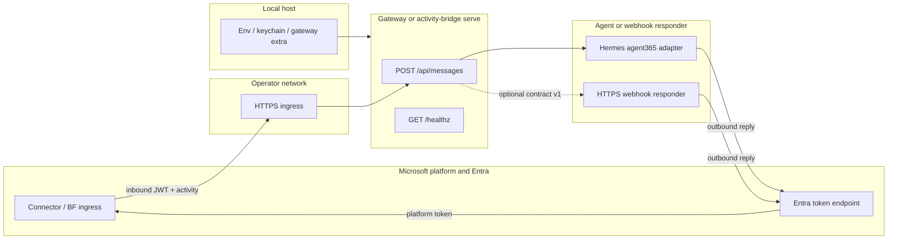

# Security model (design reference)

Hermes-A365 bridges Microsoft Agent 365 / Bot Framework ingress to an operator-controlled HTTPS endpoint and an optional downstream responder. The authoritative **public HTTP contract** is [`docs/SURFACE.md`](SURFACE.md) → **HTTP (product)**. This document describes the implemented design for outbound authentication and trust boundaries; inbound validation, routing, idempotency, secret storage detail, and rotation links are completed in later rounds. Residual inbound limits remain in [`README.md`](../README.md) → **Inbound webhook accepted residuals (#86)** — they are not duplicated here.

## Components, routes and trust boundaries

| Zone | Role |
| --- | --- |
| **Microsoft platform** | Agent 365 connector and Microsoft Entra ID issue and validate platform tokens; Entra mints outbound exchange tokens at the tenant v2.0 token endpoint (`https://login.microsoftonline.com/<tenant-id>/oauth2/v2.0/token`). |
| **Operator HTTPS ingress** | A TLS-terminated URL the operator exposes (tunnel, reverse proxy, or App Service) that reaches the bridge process. |
| **Gateway or secondary bridge** | `Agent365Adapter` inside Hermes gateway (`build_app`), or standalone `hermes a365 activity-bridge serve`. Both expose the same product routes; Path A and Path B choose different outbound token chains from inbound activity shape. |
| **Agent / responder** | Hermes gateway plugin drives the conversational agent. In **secondary bridge** mode, `activity-bridge serve` forwards each validated activity to an operator-configured HTTPS webhook responder while the bridge keeps Bot Framework wire handling ([`references/webhook-contract.md`](../references/webhook-contract.md) documents that split — see its opening scope at line 5). |
| **Local configuration / secret store** | Instance keys in operator `.env`, optional keychain/file provider, and gateway `platforms.agent365.extra` fields (inventory: [`docs/SURFACE.md`](SURFACE.md) → **Gateway config**). Blueprint and optional separate Bot Framework app credentials supply client secrets consumed at runtime. |

**Frozen product HTTP surface** ([`docs/SURFACE.md`](SURFACE.md) at the HTTP product block):

| Route | Behavior |
| --- | --- |
| `POST /api/messages` | Inbound Bot Framework / connector activities. Response categories: `400` bad activity; `401` bearer; `403` for `serviceUrl`, allowlist, or user; `200` acknowledgment bodies; gateway plugin-only `503` while connect failed. |
| `GET /healthz` | `200` with body `{"ok": true}`. |

Standalone `activity-bridge serve` additionally implements operator webhook contract version `"1"` when a `--webhook` / `HERMES_BRIDGE_WEBHOOK` responder is configured ([`docs/SURFACE.md`](SURFACE.md) HTTP line; request/response JSON in [`references/webhook-contract.md`](../references/webhook-contract.md)).

Trust boundaries: Microsoft signs inbound connector traffic; the bridge verifies before handler logic. Operator TLS and network policy protect the ingress URL. Secrets never appear in documentation examples — use placeholders such as `<tenant-id>`, `<blueprint-client-id>`, and `<agent-app-instance-id>`.

## Path A outbound: T1 → T2 → user-FIC

Path A applies when the activity recipient carries Agent 365 agentic identity fields. Outbound replies to the connector use a **three-stage** Entra exchange (not classic Bot Framework app-only `client_credentials` against `api.botframework.com`), implemented in `src/hermes_a365/activity_bridge.py`.

All stages POST form-encoded requests to `TENANT_TOKEN_URL_TEMPLATE` for the configured tenant.

| Stage | Function | Grant / inputs |
| --- | --- | --- |
| **T1** | `acquire_t1_token` | Blueprint **client_credentials** with `scope=api://AzureADTokenExchange/.default`, `fmi_path=<agent-app-instance-id>`, and blueprint client id + secret. |
| **T2** | `acquire_t2_token` | Agent instance **client_credentials** with the same FMI scope; `client_assertion` is the T1 access token (`JWT_BEARER_ASSERTION_TYPE`). |
| **user-FIC** | `acquire_user_fic_token` | `grant_type=user_fic` with `client_assertion` = T1, `user_federated_identity_credential` = T2, and `user_id` = **agentic user id**; default scope targets the Messaging Bot API service principal (`<messaging-bot-api-sp-id>/.default`). |

The messaging access token from the final stage authorizes HTTPS calls back to the inbound activity's `serviceUrl` / connector resource for that user context. Transient tokens are cached in-process with refresh skew; blueprint and agent-instance secrets load from the local configuration store described above.

## Path B outbound: BF S2S

Path B applies for classic Bot Framework **serviceUrl** shapes (Copilot Chat / separate BF registration). Outbound auth uses **Bot Framework server-to-server** minting via `acquire_bf_s2s_token`: **client_credentials** against the same per-tenant token endpoint, with scope `https://api.botframework.com/.default` (Bot Connector resource).

Credentials:

- **Preferred:** separate single-tenant Bot Framework Entra application — `A365_BF_APP_ID` and `A365_BF_CLIENT_SECRET` (see [`docs/SURFACE.md`](SURFACE.md) instance create keys).
- **Fallback:** blueprint client id + secret when BF-specific secrets are absent; agentic blueprint apps may receive Entra error **AADSTS82001** (app-only tokens refused for BF resources), which surfaces as an operator-actionable token error in code.

This path is **application-only** S2S: one cached token serves all conversations on the process. It is **not** delegated end-user on-behalf-of (OBO): there is no step that exchanges a user refresh token or presents a user session to Entra; identity is the registered bot application.

Later rounds extend this file with inbound JWT branches, authorization and routing gates, idempotency, secret inventory, and links to rotation and [`SECURITY.md`](../SECURITY.md).
