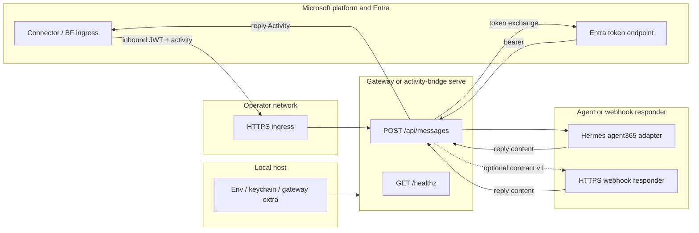

# Security model (design reference)

Hermes-A365 bridges Microsoft Agent 365 / Bot Framework ingress to an operator-controlled HTTPS endpoint and an optional downstream responder. The authoritative **public HTTP contract** is [`docs/SURFACE.md`](SURFACE.md) → **HTTP (product)**. This document describes the implemented design for outbound authentication, inbound validation, routing, secret storage, and trust boundaries. Residual inbound limits remain in [`README.md`](../README.md) → **Inbound webhook accepted residuals (#86)** — they are not duplicated here.

## Components, routes and trust boundaries

| Zone | Role |
| --- | --- |
| **Microsoft platform** | Agent 365 connector and Microsoft Entra ID issue and validate platform tokens; Entra mints outbound exchange tokens at the tenant v2.0 token endpoint (`https://login.microsoftonline.com/<tenant-id>/oauth2/v2.0/token`). |
| **Operator HTTPS ingress** | A TLS-terminated URL the operator exposes (tunnel, reverse proxy, or App Service) that reaches the bridge process. |
| **Gateway or secondary bridge** | `Agent365Adapter` inside Hermes gateway (`build_app`), or standalone `hermes a365 activity-bridge serve`. Both expose the same product routes; for authenticated ingress, successful JWT validation binds outbound Path A vs Path B (`validated_path`), and `acquire_reply_token` honors that binding instead of re-deriving the path from the unauthenticated activity body. |
| **Agent / responder** | Hermes gateway plugin drives the conversational agent. In **secondary bridge** mode, `activity-bridge serve` forwards each validated activity to an operator-configured HTTPS webhook responder while the bridge keeps Bot Framework wire handling ([`references/webhook-contract.md`](../references/webhook-contract.md) documents that split — see its opening scope at line 5). |
| **Local configuration / secret store** | Instance keys in operator `.env`, optional keychain/file provider, and gateway `platforms.agent365.extra` fields (inventory: [`docs/SURFACE.md`](SURFACE.md) → **Gateway config**). Blueprint and optional separate Bot Framework app credentials supply client secrets consumed at runtime. |

**Frozen product HTTP surface** ([`docs/SURFACE.md`](SURFACE.md) at the HTTP product block):

| Route | Behavior |
| --- | --- |
| `POST /api/messages` | Inbound Bot Framework / connector activities. Response categories: `400` bad activity; `401` bearer; `403` for `serviceUrl`, allowlist, or user; `200` acknowledgment bodies; gateway plugin-only `503` while connect failed. |
| `GET /healthz` | `200` with body `{"ok": true}`. |

Standalone `activity-bridge serve` additionally implements operator webhook contract version `"1"` when a `--webhook` / `HERMES_BRIDGE_WEBHOOK` responder is configured ([`docs/SURFACE.md`](SURFACE.md) HTTP line; request/response JSON in [`references/webhook-contract.md`](../references/webhook-contract.md)).

Trust boundaries: Microsoft signs inbound connector traffic; the bridge verifies before handler logic. Operator TLS and network policy protect the ingress URL. Secrets never appear in documentation examples — use placeholders such as `<tenant-id>`, `<blueprint-client-id>`, and `<agent-app-instance-id>`.

## Path A outbound: T1 → T2 → user-FIC

For **authenticated** inbound traffic, when JWT validation succeeds and binds `validated_path` to `"A"`, outbound replies use Path A even if the activity also carries Bot Framework–shaped fields; recipient and `serviceUrl` shape do not override that binding. Classification from activity shape (`_inbound_path_tag`: agentic ids on the recipient) applies only when validation is skipped (development) or the caller opts into decoupled routing (`None` / `"DECOUPLED"`).

Outbound replies to the connector use a **three-stage** Entra exchange (not classic Bot Framework app-only `client_credentials` against `api.botframework.com`), implemented in `src/hermes_a365/activity_bridge.py` (`acquire_reply_token` forwards the validated path).

All stages POST form-encoded requests to `TENANT_TOKEN_URL_TEMPLATE` for the configured tenant.

| Stage | Function | Grant / inputs |
| --- | --- | --- |
| **T1** | `acquire_t1_token` | Blueprint **client_credentials** with `scope=api://AzureADTokenExchange/.default`, `fmi_path=<agent-app-instance-id>`, and blueprint client id + secret. |
| **T2** | `acquire_t2_token` | Agent instance **client_credentials** with the same FMI scope; `client_assertion` is the T1 access token (`JWT_BEARER_ASSERTION_TYPE`). |
| **user-FIC** | `acquire_user_fic_token` | `grant_type=user_fic` with `client_assertion` = T1, `user_federated_identity_credential` = T2, and `user_id` = **agentic user id**; default scope targets the Messaging Bot API service principal (`<messaging-bot-api-sp-id>/.default`). |

The messaging access token from the final stage authorizes HTTPS calls back to the inbound activity's `serviceUrl` / connector resource for that user context. Transient tokens are cached in-process with refresh skew; blueprint and agent-instance secrets load from the local configuration store described above.

## Path B outbound: BF S2S

For **authenticated** inbound traffic, when JWT validation succeeds and binds `validated_path` to `"B"` (for example inbound JWT issuer is the Bot Framework issuer), outbound replies use Path B even when the activity carries agentic recipient fields. Shape-only classification (agentic ids absent and `serviceUrl` matching classic BF suffixes) is the fallback when validation is skipped or routing is explicitly decoupled.

Outbound auth uses **Bot Framework server-to-server** minting via `acquire_bf_s2s_token`: **client_credentials** against the same per-tenant token endpoint, with scope `https://api.botframework.com/.default` (Bot Connector resource).

Credentials:

- **Preferred:** separate single-tenant Bot Framework Entra application — `A365_BF_APP_ID` and `A365_BF_CLIENT_SECRET` (see [`docs/SURFACE.md`](SURFACE.md) instance create keys).
- **Fallback:** blueprint client id + secret when BF-specific secrets are absent; agentic blueprint apps may receive Entra error **AADSTS82001** (app-only tokens refused for BF resources), which surfaces as an operator-actionable token error in code.

This path is **application-only** S2S: one cached token serves all conversations on the process. It is **not** delegated end-user on-behalf-of (OBO): there is no step that exchanges a user refresh token or presents a user session to Entra; identity is the registered bot application.

## Inbound validation and authorization

Both runtimes read the bearer JWT's unverified `iss` claim (`peek_unverified_iss`) and dispatch to exactly one validator. The peek is a routing hint only; the chosen branch performs a full RS256 signature check. BF issuer `https://api.botframework.com` selects Path B validation and binds `validated_path` to `"B"`; any other peek result (including parse failure) selects Path A and binds `"A"`. That binding drives outbound `acquire_reply_token` instead of re-deriving the path from the activity body.

| Inbound branch | Signing keys (JWKS) | Algorithm | Issuer / audience / time | Additional checks | `validated_path` |
| --- | --- | --- | --- | --- | --- |
| **Path A** — A365 / MCP platform (AAD v2) | Tenant OpenID discovery → JWKS URI (`_fetch_aad_v2_keys`) | RS256 | `iss` = `https://login.microsoftonline.com/<tenant-id>/v2.0`; `aud` = blueprint Entra app id; `exp` / `nbf` required (300s leeway) | `azp` must appear in `inbound_azp_allowlist` (empty list fails closed). No `serviceUrl` claim check on this branch. | `"A"` |
| **Path B** — Bot Framework connector S2S | Static BF OpenID config at `login.botframework.com` (`_fetch_bf_jwks_keys`) | RS256 | `iss` = `https://api.botframework.com`; `aud` = `bf_app_id` when configured, else blueprint app id; `exp` / `nbf` required (300s leeway) | If the token carries a non-empty `serviceUrl` claim, it must equal the activity's `serviceUrl`. JWKS `endorsements` vs `channelId` are not checked (documented residual in README). No `azp` check. | `"B"` |

After JWT validation, both runtimes reject unsupported `channelId` values (`_inbound_channel_rejection_reason`). Optional client Bot Framework channels require explicit enablement.

**End-user authorization** runs on activities that require a user principal. Candidate senders are built in preference order: delegated JWT `oid` when present, then — on Microsoft 365 authenticated channels only — lowercase-normalized aliases from the activity body's `from` object (`aadObjectId`, `id`, `userPrincipalName`, `email`). On client or unknown channels, body `from` fields are never treated as Entra identities; only a validated JWT oid may match the allowlist. The gateway additionally evaluates body-only aliases through Hermes sender pairing (`_activity_body_user_candidates`) before the bridge allowlist check; standalone `activity-bridge serve` uses the bridge allowlist directly. Authorization succeeds when any candidate matches the configured user list or allow-all is enabled.

Aliases live in the **activity body**; inbound platform authenticity is established by JWT validation, not by calling the activity "signed."

## Routing gate and delivery idempotency

**Trusted `serviceUrl`.** Before JWT handling, both runtimes reject activities whose `serviceUrl` is not HTTPS or whose hostname fails `_is_trusted_service_url`. Allowlist entries are shape-sensitive: a leading-dot entry (for example `.botframework.com`) matches host suffixes in Microsoft's non-registrable zones; a bare hostname (for example `smba.trafficmanager.net`) matches exactly so registrable zones cannot be suffix-matched. An empty allowlist is a configuration error and yields `403`.

**Scoped delivery identity.** Dedupe keys are built by `_activity_delivery_id` from `tenant_id`, `validated_path`, canonical sender, `recipient.id`, `conversation.id`, `activity.id`, and activity `type`, with length-prefixed segments so Teams conversation ids cannot collide across parses. Missing conversation or activity ids yield `None` (not dedupable).

**Gateway plugin** (`Agent365Adapter` route): invoke activities bypass the message dedupe so Bot Framework retries receive a valid invoke response, not `{"status":"duplicate"}`. For messages, when a key exists the cache's `is_duplicate` returns `{"status":"duplicate"}`; certain lifecycle or backlog-full paths call `forget` so a retriable failure can be re-attempted. Capacity and TTL are operator-tunable via gateway `extra.idempotency_max_entries`.

**Secondary bridge** (`activity-bridge serve`): uses the same key function with `claim` state transitions (`new`, `inflight`, `done`, `busy`) and HTTP `503` backpressure while work is in flight. Channel-control types without routable ids, or dedupe disabled (`max_entries <= 0`), use a per-request ephemeral cache so nothing is retained after the request. Completed duplicates return `{"status":"duplicate"}` except invoke, which replays an empty invoke ack.

## Secret inventory and storage

Hermes owns the profile **runtime, config, skills, memory, and secrets**. Hermes-A365 consumes the selected Hermes profile and instance keys; it does not take over profile ownership.

| Secret / cache | Purpose | Consumer | Persistence | Storage owner |
| --- | --- | --- | --- | --- |
| Blueprint client id + secret | Path A inbound `aud`, Path A outbound T1/T2/FIC | Gateway adapter, `activity-bridge serve` | At rest until rotated | Operator: profile `.env` / gateway `extra` / `a365.generated.config.json` (runtime-specific precedence below), optional OS keychain via `secrets_provider` on miss only |
| BF app id + client secret (`A365_BF_*`) | Path B inbound `aud` (when set), Path B outbound S2S | Same runtimes | At rest until rotated | Operator per-agent `.env` (serve) or profile `.env` / `extra` (gateway); keychain fill-on-miss same contract as blueprint |
| T1 / T2 FMI pair | Path A outbound exchange | Bridge token mint | In-process TTL cache (`_FmiCache`) | Process memory |
| Per-user messaging token | Path A reply bearer | Bridge reply POST | In-process TTL cache (`_UserTokenCache`) | Process memory |
| BF S2S access token | Path B reply bearer | Bridge reply POST | In-process TTL cache (`_BfTokenCache`) | Process memory |
| Inbound JWKS material | JWT signature verification | Both runtimes | In-process refresh cache (`_JwksCache`, separate BF vs AAD instances) | Process memory |
| Delivery idempotency records | Connector retry suppression | Gateway cache / serve cache | In-process TTL + entry cap | Process memory |
| `a365` CLI MSAL token cache | Upstream `a365` operator tool auth | Operator workstation CLI | Persistent file under the CLI app data path (see [`references/a365-cli-reference.md`](../references/a365-cli-reference.md) auth model) | Operator host |

**Plaintext-before-provider precedence** (documented in [`README.md`](../README.md) → **Secrets at rest**): the active plaintext tier for the selected runtime and multiplex mode always wins; `resolve_secret` / `resolve_secret_state` consults the pluggable provider only on a miss, so a freshly rotated generated-config secret cannot be shadowed by a stale keychain entry. Gateway reads profile-scoped `A365_*` and optional `gateway.platforms.agent365.extra` secrets; with multiplex enabled, only the active `HERMES_HOME` scope applies. `activity-bridge serve` reads blueprint secret from `a365.generated.config.json` (not operator `.env`) and BF secret from the per-agent `.env`. Generated config, profile `.env`, and agent `.env` files must be mode `0600` (enforced on gateway load). Optional macOS/Linux keychain storage uses `python -m hermes_a365.keychain store` when the plaintext tier is cleared.

## Rotation and reporting

Client secret rotation, overlap windows, and restart expectations are documented in [`references/client-secret-rotation.md`](../references/client-secret-rotation.md). Report suspected vulnerabilities privately per [`SECURITY.md`](../SECURITY.md) (GitHub private advisories preferred).

Deliberate inbound authentication and dedupe limits (M3, F6, F7) stay in [`README.md`](../README.md) → **Inbound webhook accepted residuals (#86)**; they are not expanded here.
